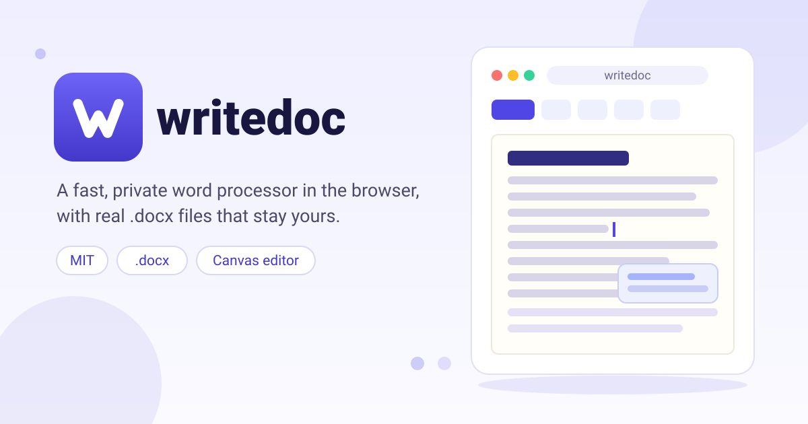

<p align="center">
  
</p>

<p align="center">
  <a href="https://salim-studio.github.io/writedoc/"></a>
  <a href="https://github.com/salim-studio/writedoc/actions/workflows/deploy-pages.yml"></a>
  
</p>

> **Your words. Your files. Yours.**
>
> writedoc is a word processor that treats your writing like it is yours:
> it opens fast, stays out of your way, and keeps real `.docx` files in
> your hands. No accounts to feed, no formats to ransom, no telemetry
> deciding what you meant.

<p align="center">
  <a href="https://github.com/salim-studio/writedoc/releases/latest/download/writedoc-1.0.0-setup.exe"></a>
  <a href="https://github.com/salim-studio/writedoc/releases/latest/download/writedoc-1.0.0-portable.exe"></a>
  <a href="https://github.com/salim-studio/writedoc/releases/latest/download/writedoc-1.0.0.apk"></a>
  <a href="https://salim-studio.github.io/writedoc/"></a>
</p>

## Why writedoc exists

Most writing tools rent your words back to you — your files on their
servers, your habits in their analytics, your documents in formats only
they fully understand. writedoc starts from the opposite assumption:
**the application is a guest, and your files are the home.**

- **Private by construction.** The canvas editor runs entirely in your
  browser. The playground and mock pages work with no account at all,
  and nothing you write ever leaves your machine unasked.
- **Honest files.** What you write is saved as genuine
  Office Open XML (`.docx`), byte-preserving the parts writedoc does
  not touch — so Word, LibreOffice, and your future self can always
  open it.
- **An original engine, not a wrapper.** Layout, pagination, and
  painting are built from scratch on canvas, with metric-compatible
  fonts and a conformance record that says exactly which parts of
  ECMA-376 are supported — and which are not yet.
- **Calm software.** Flat surfaces, keyboard-first navigation, and
  controls that explain themselves. Fewer surprises, more writing.

## What it can do

<details>
<summary><strong>Write</strong> — the everyday act, taken seriously</summary>

- Type, delete, split and merge paragraphs; bold, italic, underline,
  strikethrough; font sizes in half-point steps; unlimited undo and redo
- Left, center, right and justified alignment; custom line spacing,
  exact and minimum heights, before/after spacing
- Indents and tab stops with dot, dash and line leaders;
  keep-with-next, keep-lines-together, widow and orphan control
- Bullets and numbering, reusable paragraph and character styles,
  outline levels with document navigation
- Click, drag, Shift+click and full keyboard selection across
  paragraphs and pages; native input methods and a plain-text mode
</details>

<details>
<summary><strong>Review</strong> — think together, carefully</summary>

- Comment threads in a margin column: reply, edit, resolve, delete
- Track Changes with All, Simple, No Markup and Original views;
  accept, reject, change bars and a Reviewing Pane
- Read Aloud, spelling with personal dictionary, word count with goals
</details>

<details>
<summary><strong>Structure</strong> — long documents stay navigable</summary>

- Table of contents, footnotes at the foot of the page, captions (SEQ),
  cross-references (REF/PAGEREF), Update Fields (F9)
- Headers and footers with page numbers, Different First Page and
  Different Odd & Even Pages
- Single-section page setup: Letter, A4, Legal or custom sizes,
  orientation, margins and gutter; manual and paragraph page breaks
</details>

<details>
<summary><strong>Tables &amp; pictures</strong> — the unglamorous essentials</summary>

- Fixed-width and AutoFit tables, merged cells, rows that flow across
  pages, repeated headers, editable row heights
- Inline PNG/JPEG with sizing, cropping, flips, rotation, alt text —
  your original image bytes preserved untouched
</details>

<details>
<summary><strong>Files</strong> — in and out, without friction</summary>

- Open and download `.docx` locally; save and reopen your files online
- Export searchable PDF; start from Letter, Meeting notes, Report,
  Résumé or Essay templates
- Import plain text (one paragraph per line), Markdown and HTML with
  headings, lists, emphasis and links
- Real-time co-editing of shared files, version history, and one-click
  publishing to the web
</details>

## What it cannot do yet

writedoc is a prototype with strong opinions and known boundaries: one
section per file, no nested tables or floating pictures, and files that
lean on unsupported structures open read-only rather than risk your
content. The [engine guide](docs/canvas-engine.md) and the
[conformance record](docs/conformance.md) document every supported
subset and every remaining gap — surprises are a bug, and documented
limits are a feature.

## Run it

No installation. The live build is always here:

**https://salim-studio.github.io/writedoc/**

Or run it on your own machine:

```sh
npm ci
npm run dev
```

| Page | What it is |
| ---- | ---------- |
| `/` | The app, with file saving |
| `/playground.html` | The editor alone — no account, just writing |
| `/mock.html` | The full app against an in-memory store |
| `/mirror.html` | The open file, mirrored in a second window |

## Desktop app

Windows builds are published on the
[releases page](https://github.com/salim-studio/writedoc/releases): a
one-click installer and a portable exe that needs no install. Both run
offline and keep your documents in the app's own local store on your
machine — nothing is sent anywhere.

Or pick a build from the download bar at the top of this page. Build them yourself:

```sh
npm ci
npm run desktop:dist   # installer + portable exe into release/
npm run desktop        # production build, then open the app
```

The shell is [Electron](https://www.electronjs.org/) and lives in
`electron/main.cjs`: it serves `dist/` from a private `app://` origin so
the app's storage behaves exactly as it does in a browser. macOS (`dmg`)
and Linux (`AppImage`) targets are configured (`npm run desktop:dist:all`)
but are not shipped yet.
[.github/workflows/desktop.yml](.github/workflows/desktop.yml) builds the
Windows artifacts on demand and attaches them to `v*` tags.

## Android app

An APK is published on the
[releases page](https://github.com/salim-studio/writedoc/releases) and in the download bar at the top —
Android 7.0 (API 24) and newer, sideload it and write offline.

The app is wrapped with [Capacitor](https://capacitorjs.com/) from the same
`dist/` build, so documents live in the WebView's local store on the
device. `android/` is the native project; `capacitor.config.json` ties it
to the web build.

```sh
npm run android:sync   # build the web app and copy it into android/
npm run android:apk    # same, then assemble a release APK (needs a JDK + Android SDK)
```

[.github/workflows/android.yml](.github/workflows/android.yml) builds the
APK in CI: set `WRITEDOC_KEYSTORE_BASE64`, `WRITEDOC_KEYSTORE_PASSWORD`,
`WRITEDOC_KEY_ALIAS` and `WRITEDOC_KEY_PASSWORD` as repository secrets to
sign with your own key (otherwise it signs with a throwaway key).

## For developers

```sh
npm run check:licenses   # dependency policy: no AGPL, ever (see AGENTS.md)
npm test                 # unit suite (vitest)
npm run test:browser     # browser suite (Playwright; Chrome by default)
npm run check:conformance  # independent DOCX schema checks (needs Python tools)
npm run build            # production build into dist/
npm run desktop:dist     # Windows installer + portable exe into release/
```

Every push to `main` is built and published to GitHub Pages by
[.github/workflows/deploy-pages.yml](.github/workflows/deploy-pages.yml).

```text
src/engine/model.js          the document and its editing transactions
src/engine/docx.js           DOCX preservation and serialization
src/engine/page-settings.js  page measurements and geometry
src/engine/layout.js         wrapping, pagination, on-page geometry
src/engine/font-metrics.js   metrics from the bundled Noto tables
src/engine/canvas-editor.js  the canvas renderer and input adapter
src/views/editor.js          chrome, menus and storage integration
src/playground.js            the standalone harness
src/lib/doc.js               save, conflict, version and lifecycle model
public/fixtures/             independently generated sample DOCX
public/fonts/                Noto Sans, license and provenance
```

## License

© 2026 salim-slimani.

writedoc is [MIT](LICENSE). Its engine is original work; `fflate` and
`yjs` are MIT; Noto Sans is [OFL-1.1](public/fonts/OFL.txt) with
[source provenance](public/fonts/PROVENANCE.md); everything else is
listed in [third-party notices](public/licenses/THIRD_PARTY.txt).
